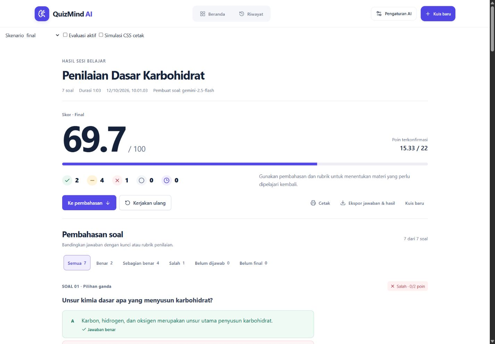
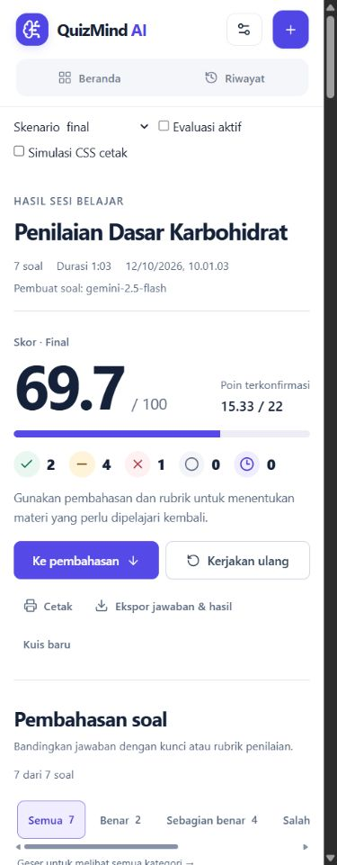
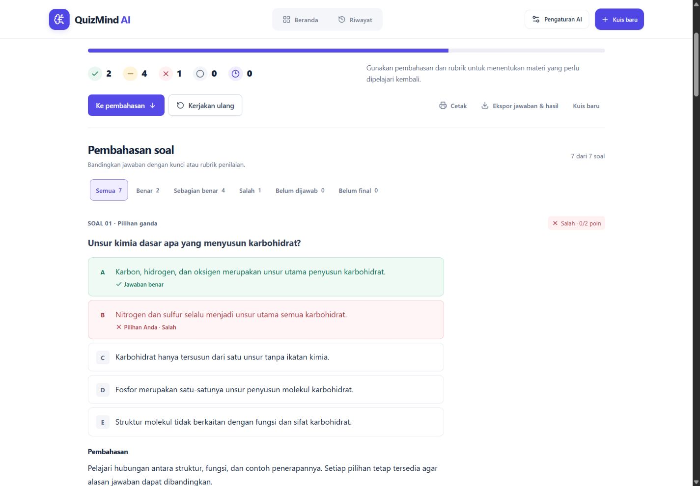
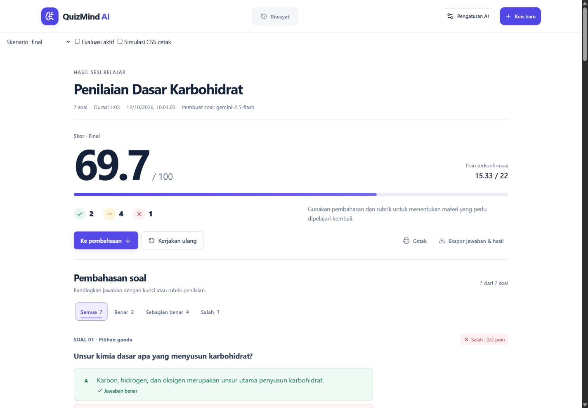
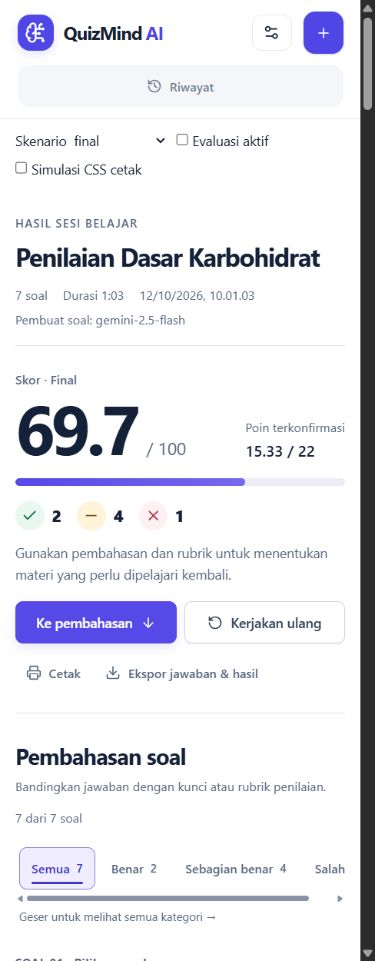
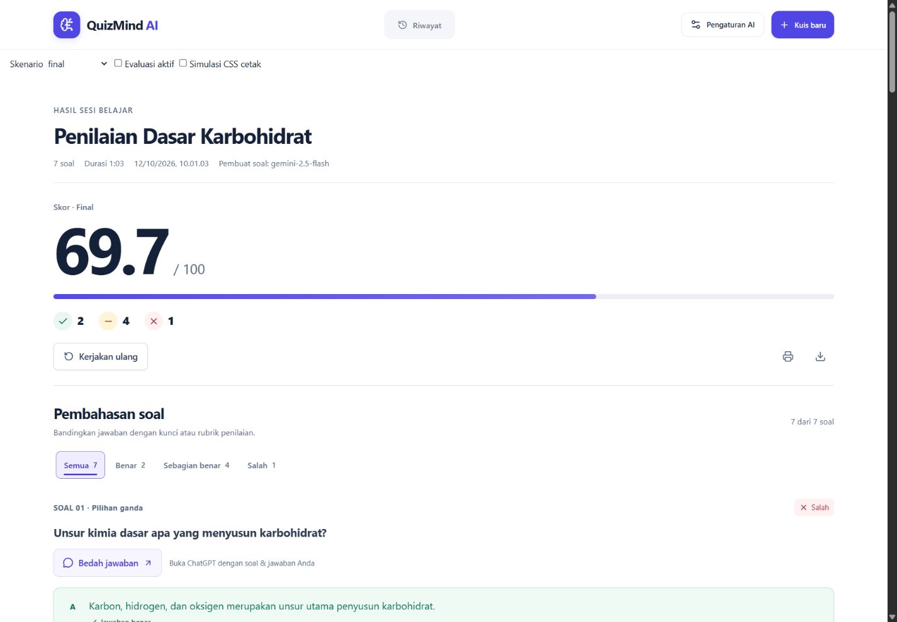
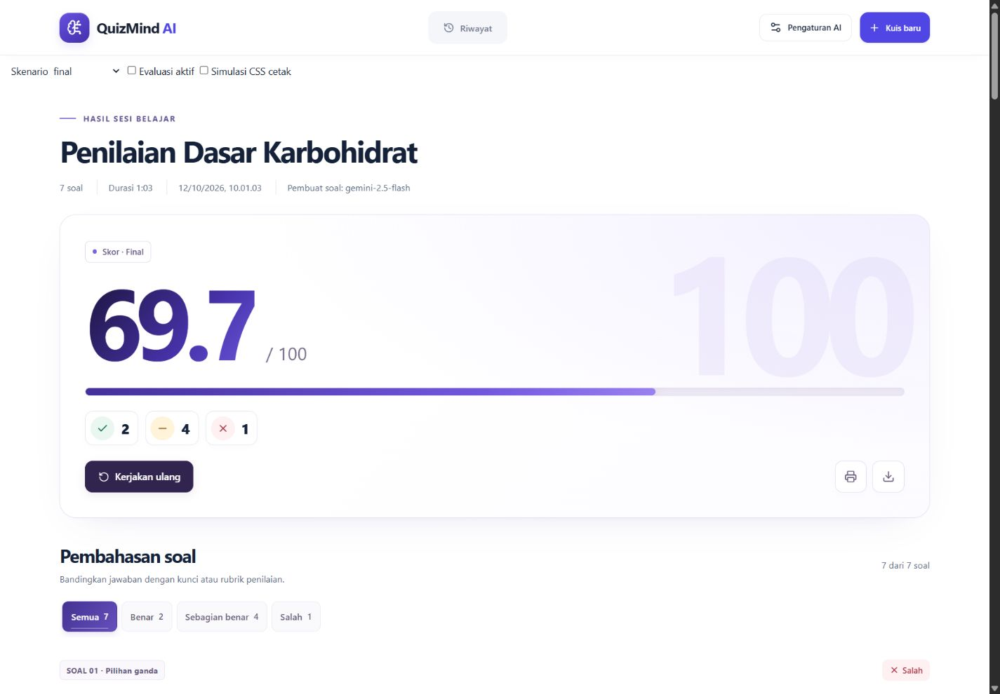
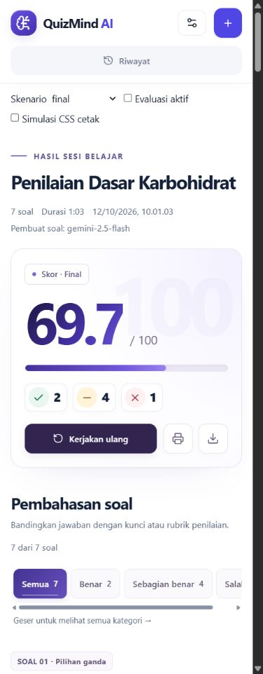

# Penyempurnaan tampilan hasil

Revisi berdasarkan arahan pengguna setelah redesign awal, 12 Oktober 2026. Perubahan kode berada pada `src/components/QuizResults.tsx` dan aturan hasil di `src/index.css`.

- Skor menjadi elemen dominan: 104px pada desktop 1440px dan 72px pada mobile. Poin terkonfirmasi tetap terpisah.
- Area skor memakai seluruh lebar ringkasan. Track nilai memanjang sampai tepi kanan; panjang isi bar tetap mengikuti skor asli.
- Lima jumlah status berada di bawah bar sebagai ikon dan angka. Label tersedia melalui title, definisi teks untuk screen reader, dan label tertulis saat cetak.
- Latar halaman hasil serta header putih. Warna halaman lain tetap mengikuti tema masing-masing.
- Kartu tipis digunakan untuk semua opsi, teks jawaban, kelompok rubrik, pilihan matching, pasangan matching dan item ordering. Status benar/salah tetap memakai tint lembut, teks dan ikon; seluruh opsi netral tetap terlihat.
- Skor belum final tetap placeholder dan tidak menampilkan bar nilai final. Kontrak scoring dan penyimpanan tetap sama.

## Verifikasi yang dijalankan

| Pemeriksaan | Hasil |
| --- | --- |
| `npm run test:results` | PASS, seluruh 7 kelompok regresi. |
| `npm run lint` | PASS. |
| `npm run build` | PASS frontend, server Node, Worker; peringatan chunk >500kB yang sudah ada tetap muncul. |
| `git diff --check` | PASS. |
| Browser 320, 360, 390, 430, 768, 1024, 1440px | PASS, tanpa overflow horizontal. |
| Lebar track skor | PASS, sama dengan lebar area skor pada seluruh viewport. |
| Posisi jumlah status | PASS, berada di bawah bar pada seluruh viewport. |
| Latar halaman | PASS, computed background putih pada seluruh viewport. |
| Semua pilihan | PASS, 12 opsi fixture tetap ada: 5 single + 5 multi + 2 true/false. |
| Pending | PASS, skor placeholder, tanpa bar final, dua soal belum final tetap tercatat. |
| Simulasi CSS print dengan filter Salah aktif | PASS, seluruh 7 soal dan 12 opsi tampil; label status menjadi teks yang terlihat. Pagination cetak asli belum diperiksa. |

Bukti ukuran dan label: `.qa/results-redesign/premium-responsive.json`. Batas QA perangkat fisik, screen reader nyata, zoom browser dan printer dari laporan awal tetap berlaku. Tidak dilakukan deployment pada revisi ini.

## Screenshot

## Revisi lanjutan: motion dan penyederhanaan aksi

Arahan lanjutan pengguna diterapkan: animasi masuk header/ringkasan, reveal skor, pengisian bar, stagger status/soal/opsi, hover kartu, respons tombol saat ditekan, transisi filter dengan indikator aktif, dan pembukaan kontrol manual. Gerak memakai transform/opacity dan transisi 220–1000ms; semua animasi masuk mempunyai satu iterasi. Tidak ada animasi dekoratif yang berjalan terus-menerus. Reduced-motion dan cetak mematikan gerak; cetak memaksa konten tetap terlihat penuh.

Jumlah status nol kini dihilangkan dari ringkasan serta filter. Enam kategori tetap tersedia dalam pemetaan data, tetapi hanya kategori berisi soal yang tampil. Jika nilai berubah sehingga kategori yang dipilih menjadi kosong, filter kembali ke Semua. Semua soal tetap ada dalam DOM untuk cetak, dan draft nilai manual tetap berada dalam komponen yang sama saat filter berganti.

Kuis baru hanya ada sekali di header; tombol duplikat dalam ringkasan dihapus. Pada halaman hasil, logo tetap menjadi navigasi beranda sehingga tombol Beranda kedua di header dihapus. Cetak, ekspor, retake, retry per soal, serta penerimaan nilai usulan tetap ada karena tugasnya berbeda. Guard evaluasi aktif tetap melindungi Kuis baru dan retake.

`npm run test:results`, lint, build, dan diff check lulus. Browser diperiksa pada 320/360/390/430/768/1024/1440px: tanpa overflow, tanpa status nol, 12 opsi fixture lengkap, dan tepat satu tombol Kuis baru. Filter parsial menampilkan empat soal. Simulasi CSS print dengan filter Salah aktif tetap menampilkan tujuh soal, opacity opsi 1, dan animationName `none`. Data QA: `.qa/results-redesign/motion-responsive.json`. Preferensi reduced-motion OS dan printer asli belum diuji langsung.

## Revisi ringkasan dan skala nilai

Tombol Ke pembahasan, analisis ringkasan, dan seluruh blok Poin terkonfirmasi dihapus. Cetak dan ekspor hanya memakai ikon 44×44px, dengan aria-label dan tooltip tetap tersedia.

Nilai per soal ditampilkan pada skala 0–100. Badge soal yang bersifat benar/salah saja (single choice, true/false, multiple/ordering exact, dan short answer tanpa partial) menampilkan status saja. Soal dengan penilaian parsial menampilkan nilai seperti 50/100 atau 80/100. Nilai usulan, audit sebelumnya, dan prompt Bedah jawaban menggunakan skala yang sama; penilaian pending tetap placeholder.

Input manual memakai batas 0–100 dan mengonversi nilai ke skala penyimpanan sebelum memanggil callback lama. Contoh esai maxPoints 10: input 90 disimpan sebagai 9 dan ditampilkan kembali 90/100, dengan audit lama 80/100. Bobot/perhitungan skor total dan data tersimpan tidak dimigrasikan oleh perubahan presentasi ini.

Sepuluh kelompok tes hasil/review, lint, build dan diff check lulus. Browser memverifikasi semua teks yang diminta telah hilang, Cetak/Ekspor tanpa visible text namun tetap berlabel, nilai 101 diblokir, dan nilai manual 90 beserta alasan tersimpan benar.

## Revisi visual: premium, megah dan tactile

Ringkasan kini memakai satu surface utama dengan sudut 18–24px, pencahayaan ungu sangat lembut, dan shadow tipis. Angka skor memakai tipografi 76–152px serta warna ink-to-violet. Watermark skala 100 murni dekoratif (`aria-hidden`), tidak menjadi nilai baru. Bar mendapat kilau satu kali setelah reveal; tidak ada animasi loop. Status memakai chip ikon/angka; retake mempunyai bobot visual kuat, sedangkan cetak/ekspor tetap ikon.

Heading, metadata, filter aktif, label soal dan tombol Bedah jawaban ditata ulang dalam ritme yang konsisten. Kartu jawaban mempunyai radius, border, depth dan respons hover/press yang lebih terasa. Status benar/salah tetap terbaca melalui teks/ikon/warna. Latar luar tetap putih; lebar widescreen, pilihan lengkap, status nol tersembunyi, nilai per soal skala 100 dan fungsi lama dipertahankan.

Lint, 10 kelompok tes regresi, build dan diff check lulus. Browser 320/390/768/1440/1920/3440px tanpa overflow; 12 opsi fixture utuh, status nol tidak muncul, kilau beriterasi satu. Simulasi print tetap menampilkan semua tujuh soal dengan animasi mati dan watermark tersembunyi. Reduced-motion menghilangkan gerak dan kilau melalui CSS; preferensi OS nyata dan printer fisik tetap belum diuji. Data: `.qa/results-redesign/grand-premium-responsive.json`.

# Revisi night blue dan dua alur pengerjaan

- Angka dekoratif 100 di kanan hero dihapus. Skor utama, progress lebar, latar putih, status nonzero, dan cetak/ekspor ikon tetap dipertahankan.
- Palet hasil/pembahasan dan header hasil diganti menjadi night blue; warna semantik benar, sebagian benar, dan salah tetap dibedakan.
- Generate ulang membuat operasi AI baru dengan konfigurasi dan preferensi generasi asli. Snapshot disimpan bersama kuis dan bertahan setelah JSON dimuat kembali. Kuis lama menggunakan konfigurasi yang tersedia atau dapat diturunkan dari soal; materi dan konfigurasi yang dahulu tidak tersimpan tidak dapat dipulihkan, sehingga UI menampilkan keterangan.
- Remedial mengosongkan progres dan membuka soal identik tanpa memanggil provider. Riwayat hasil sebelumnya tetap disimpan. Kedua aksi dijaga terhadap evaluasi aktif dan pemanggilan ganda.
- Posisi utilitas berada di kanan pada desktop; tombol di ponsel minimal 44px. Lebar 320, 390, 768, 1440, 1920, dan 3440 diperiksa tanpa overflow horizontal. Pada 320px, tombol ditumpuk dengan tinggi 44px.
- Validasi: lint, 11 kelompok test:results, test:composer (termasuk pengujian alur App dengan provider simulasi), build, dan git diff --check berhasil. Build menyisakan peringatan ukuran chunk yang sudah dikenal. Tidak melakukan generasi berbayar langsung untuk QA.
- Bukti visual: `results-review/night-blue-1440.jpg` dan `results-review/night-blue-390.jpg`. Preview memanggil callback simulasi; integrasi aksi sebenarnya diverifikasi lewat pengujian App.

