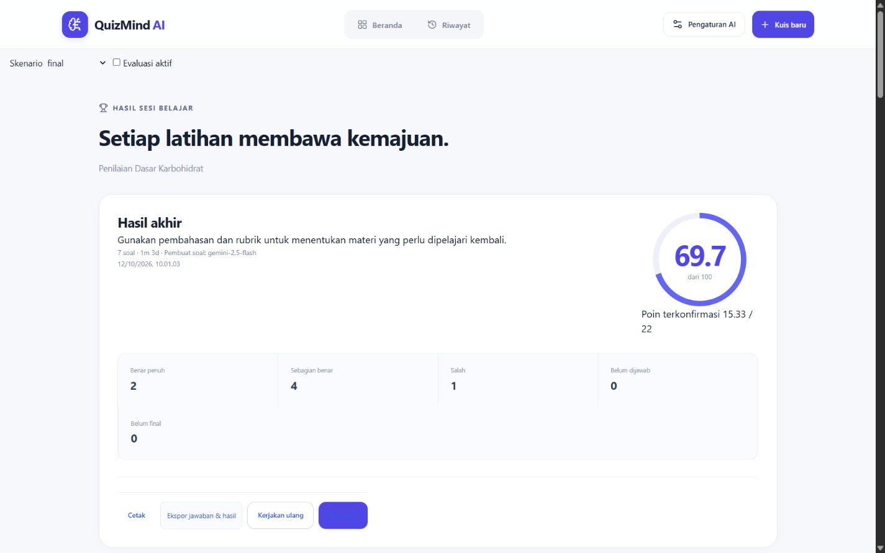
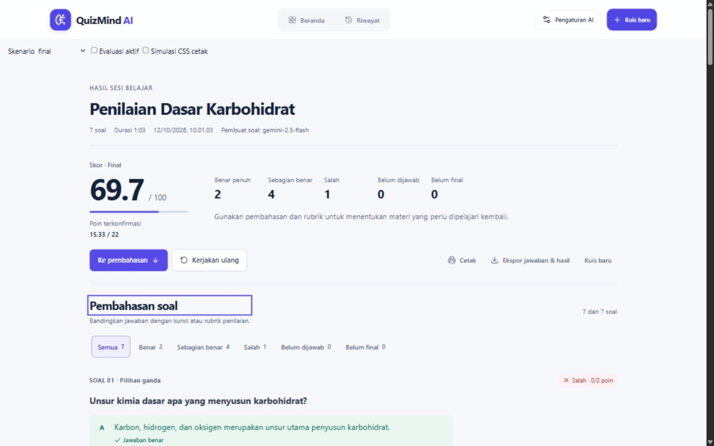
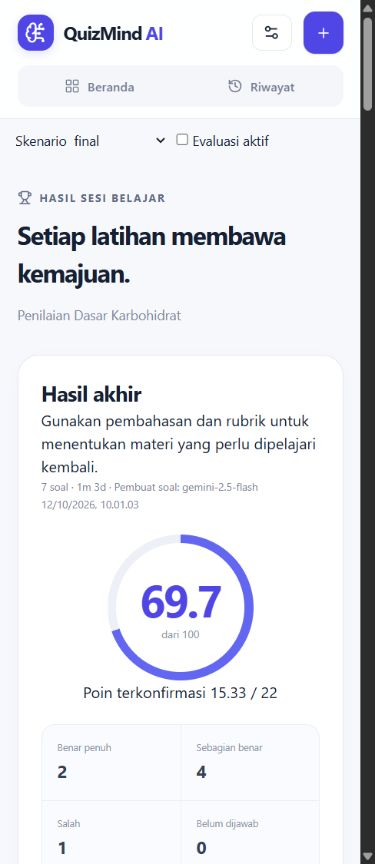
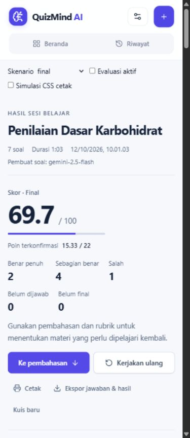
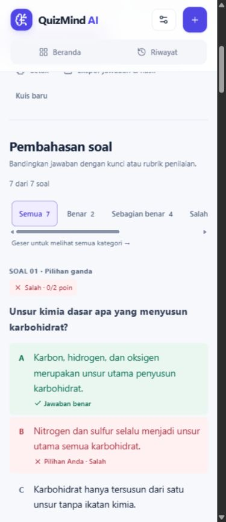

# Redesign hasil kuis dan pembahasan

Implementasi lokal berdasarkan 22 halaman `D:\Downloads\QuizMind_AI_Audit_UIUX_Task_Plan_Codex.pdf`, 12 Oktober 2026. Branch: `codex/results-review-redesign`. Lingkup: tampilan hasil dan pembahasan, semantik status, navigasi, aksesibilitas, serta pengujian. Algoritme scoring, API, database, autentikasi, generator, dan format penyimpanan tetap memakai implementasi sebelumnya.

## Hasil implementasi

- Judul kuis menjadi H1. Metadata, skor final/belum final, poin terkonfirmasi, lima metrik, dan tindakan disusun tanpa kartu overview besar atau ring skor.
- CTA utama **Ke pembahasan** melakukan scroll dan memindahkan fokus ke heading review. Preferensi reduced-motion diperiksa sebelum memilih scroll halus.
- Kerjakan ulang, kuis baru, cetak, ekspor, evaluasi ulang, pembatalan evaluasi, dan pengaturan evaluator tetap terhubung dengan callback semula. Kuis baru pada header juga dinonaktifkan selama evaluasi aktif.
- Semua enam filter mempunyai jumlah hasil, `aria-pressed`, dan status jumlah yang diperbarui. Filter kosong menampilkan pesan dan tombol kembali ke Semua. Filter mobile dapat digeser dan memiliki petunjuk tekstual. Toolbar tidak dibuat sticky sehingga tidak menutup teks pada viewport kecil.
- Setiap soal memakai section dengan divider. Status benar, parsial, salah, belum dijawab, dan belum final dibedakan dengan teks/ikon/warna. Kegagalan, pembatalan, proses evaluasi, serta kebutuhan tinjauan mempertahankan label masing-masing.
- Semua opsi pilihan ganda/multi-select/benar-salah tampil dalam urutan sumber, tanpa accordion atau truncation. Pilihan yang sekaligus benar dan dipilih menampilkan kedua indikator. Multi-select juga menandai opsi tidak dipilih.
- Isian menampilkan teks lengkap, acuan, jawaban yang diterima, dan konsep. Esai menampilkan seluruh kriteria, bobot, anchor, tingkat keterpenuhan, bukti, dan feedback.
- Matching menampilkan seluruh pilihan kanan, termasuk distractor, lalu pasangan pengguna/kunci/status tiap item kiri. Ordering mempertahankan seluruh item; jawaban belum dikonfirmasi tidak ditampilkan sebagai urutan final pengguna.
- Nilai usulan AI, review flags, feedback evaluator, provenance, alasan manual, nilai sebelumnya, dan nomor revisi tersedia. Perubahan manual tetap membutuhkan alasan dan poin dalam rentang 0..maxPoints.
- Seluruh soal tetap berada dalam DOM. CSS menyembunyikan soal yang tidak cocok untuk layar dan menampilkannya kembali saat cetak. Cetak tidak kehilangan soal akibat filter aktif; tombol interaktif disembunyikan dan URL sumber tetap terlihat.
- Token warna/spacing/typography dibatasi pada `.results-page`. Body 16px, label minimum 12px, fokus 3px, kontrol tombol minimum 44px, konten maksimum 1120px dan teks review maksimum 85ch.

## Checkpoint task plan

| Paket | Status | Bukti |
| --- | --- | --- |
| T00 Baseline | PASS | Working tree awal bersih; branch terpisah; inspeksi komponen/App/types/scoring; npm ci, lint, build dan tes awal; screenshot 1440/390; fixture tujuh tipe. |
| T01 Tokens | PASS | CSS scoped hasil/review; tidak mengganti token creator atau konfigurasi. |
| T02 Summary | PASS | Skor, poin, distribusi tetap dari hasil asli; ring/kartu overview diganti struktur ringkas. |
| T03 Actions | PASS | CTA fokus/scroll; callback lama serta guard evaluasi diverifikasi. |
| T04 Filter/review | PASS | Enam filter, jumlah hasil, empty state dan reset diuji di browser. |
| T05 All choices | PASS | Lima opsi single, 96 kombinasi multi (2/3/4 kunci × 32 pilihan), opsi legacy/dinamis, dan dua opsi true/false. |
| T06 Non-choice | PASS | Isian/esai panjang/kosong, lima kriteria rubrik, matching/ordering 3–8 item, distractor, manual audit. |
| T07 Responsive | PASS untuk viewport lokal | 320, 360, 390, 430, 768, 1024, 1440px tanpa overflow; teks tanpa spasi 1050 karakter diuji lagi pada 320/390/768. Perangkat fisik/keyboard virtual belum diuji. |
| T08 Motion/a11y | PARTIAL QA | Kontras aktual, keyboard/fokus dan semantik diuji; media reduced-motion serta cabang scroll tersedia. Screen reader nyata, preferensi OS reduced-motion dan zoom browser 200% belum diverifikasi. |
| T09 Print/export | PARTIAL QA | Unduhan JSON asli diuji; simulasi memakai deklarasi CSS print sebenarnya dan memuat semua konten. Pagination/printer asli belum diuji. |
| T10 Release QA | PARTIAL penerimaan | Build/tes lokal dan screenshot selesai; batas pemeriksaan perangkat/print/zoom di atas masih membutuhkan QA sebelum menyatakan seluruh release gates terpenuhi. |

## File dan diff

| File | Perubahan |
| --- | --- |
| `src/components/QuizResults.tsx` | Summary, aksi, filter, status, empty state, fokus, DOM lengkap untuk print, kontrol manual. |
| `src/components/QuestionReview.tsx` | Renderer per tipe, semua pilihan, rubrik, sumber, feedback, riwayat manual. |
| `src/resultPresentation.ts` | Pemetaan status/filter presentasi; tanpa menghitung ulang nilai. |
| `src/components/TopBar.tsx` | Guard tombol Kuis baru ketika `isBusy`. |
| `src/index.css` | Layout editorial, responsive, status, aksesibilitas, print, reduced-motion scoped. |
| `scripts/results-review-fixture.ts` | Tujuh tipe dan delapan skenario deterministik. |
| `scripts/results-review-test.ts` | Regresi konten/nilai/export/guard dan pemeriksaan aturan. |
| `scripts/results-review-preview.html` / `.tsx` | Fixture browser lokal dengan callback terisolasi; tidak memanggil AI atau menyimpan akun. |
| `package.json` | Skrip `test:results`. |
| `.github/workflows/pages.yml` | `test:results` sebagai gate sebelum build/deploy CI. Workflow belum dijalankan di GitHub pada tugas ini. |
| Dokumen ini dan `results-review/` | Laporan dan screenshot sebelum/sesudah. |

## Perintah yang benar-benar dijalankan

| Perintah | Hasil |
| --- | --- |
| `npm ci --no-audit --no-fund` | PASS, dependency dipasang dari lockfile. |
| `npm run lint` | PASS baseline dan setelah implementasi. Satu kesalahan ID kesulitan pada fixture diperbaiki menggunakan `moderate` dari tipe proyek. |
| `npm run build` | PASS baseline dan setelah implementasi: frontend, server Node dan Worker. |
| `npm run test:results` | PASS 7 test groups. Ekspektasi JSON sempat membandingkan properti `undefined`; test diperbaiki agar membandingkan kontrak serialisasi JSON asli, tanpa perubahan exporter. |
| `npm run test:composer` | PASS workflow composer, configuration dan App operations. |
| `npm run test:quality` | PASS 16 tes. |
| `npm run test:generation` | PASS stream, efficiency dan quality gate; provider simulasi. |
| `node --import tsx scripts/quiz-types-test.ts` | PASS tujuh tipe/scoring, legacy migration, evaluator/revision/failure/budget/fallback. |
| `node scripts/smoke-test.mjs` | PASS halaman, aset, health, validasi endpoint dan aset biner Worker. |
| `git diff --check` | PASS. |

Build masih memberi peringatan chunk utama >500kB, juga ada pada baseline. Pemecahan bundle tidak dilakukan karena di luar lingkup redesign. Tes provider di atas menggunakan simulasi; tidak ada panggilan AI berbayar atau evaluasi akun produksi.

## Matriks regresi PDF A–L

| Kasus | Hasil | Bukti |
| --- | --- | --- |
| A Single benar | PASS | 5 opsi berurutan; kunci dan pilihan Anda hadir bersamaan. |
| B Single salah | PASS | 5 opsi; pilihan salah dan kunci berbeda bertanda. |
| C Multiple select | PASS | Semua 5 opsi; 2–4 kunci; seluruh kombinasi pilihan dan nilai parsial. |
| D True/false | PASS | Kedua nilai tampil pada true/false/null. |
| E Short answer | PASS | Jawaban panjang/kosong, acuan, accepted answers, konsep dan feedback. |
| F Essay | PASS | 5 rubrik/weight/anchor/level/evidence, nilai usulan, kontrol dan audit manual. |
| G Matching | PASS | 3–8 kiri, seluruh kanan termasuk distractor, user/key dan belum dipasangkan. |
| H Ordering | PASS | 3–8 item di kedua daftar; confirmed/unconfirmed tidak dipalsukan. |
| I Non-final | PASS | pending/failed/cancelled/needs_review tidak masuk filter salah; skor belum final memakai placeholder. |
| J Filter/empty | PASS | Browser menghasilkan 7/2/4/1/0/0; kedua kategori kosong mempunyai pesan/reset. |
| K Actions | PASS lokal / PARTIAL print fisik | Retake/new/evaluate/cancel/retry/settings, terima usulan AI, guard aktif, unduhan JSON dan CSS print diperiksa. Printer/pagination asli belum diperiksa. |
| L Scoring invariant | PASS | Snapshot delapan skenario, render tidak memutasi hasil, exporter serialisasi identik, modul scoring tidak diubah. |

Contoh snapshot final: skor/finalScore 69.7, earnedPoints 15.3334/22, benar 2, parsial 4, salah 1, unanswered/pending 0. Skenario belum final: score terkonfirmasi 24.24, finalScore null, earnedPoints 5.3334/22, pending 2. Nilai manual 9/10 menghasilkan score 74.24 dengan riwayat sebelumnya utuh. Perbedaan skor dan jumlah jawaban benar tidak disebut sebagai akurasi baru.

## QA browser dan ukuran

Chromium in-app di `http://127.0.0.1:5173/scripts/results-review-preview.html`. Ukuran yang diminta dan ukuran CSS aktual dicatat. Scrollbar desktop sekitar 15px dikurangkan dari clientWidth; tidak ada overflow konten.

| Viewport | Sebelum: heading hasil → awal review | Sesudah | Pengurangan |
| --- | ---: | ---: | ---: |
| 1440 × 900 | 766.10px | 432.35px | 43.57% |
| 390 × 900 | 1019.90px | 689.75px | 32.37% |

Pengukuran menggunakan fixture identik dan selisih bounding box heading/section, sehingga tambahan panel QA di luar halaman tidak memengaruhi selisih. Pengurangan melampaui target 20–30%; teks jawaban panjang dan informasi penilaian tetap lengkap.

- Tujuh breakpoint: tidak ada scroll horizontal halaman; seluruh tombol hasil yang terlihat memiliki tinggi minimal 44px.
- Kata tanpa spasi 1050 karakter dan judul panjang tetap membungkus pada 320/390/768px.
- CTA memfokuskan `review-heading`; Tab berikutnya menuju filter Semua dengan outline solid. Header sticky tidak menutupi heading pada viewport yang diuji.
- Pengukuran 74 sampel teks utama/status/filter/opsi/sumber: minimum kontras **5.39:1**, seluruh sampel >=4.5:1. Ini audit bagian yang diubah, bukan sertifikasi WCAG seluruh aplikasi.
- Manual QA: poin 11 untuk soal maksimum 10 diblokir; poin valid tanpa alasan diblokir; poin 9 dengan alasan tersimpan bersama revisi 1 dan nilai sebelumnya. Terima usulan AI tetap berfungsi.
- Evaluasi aktif: retake dan kedua tombol kuis baru disabled; kontrol nilai manual tersembunyi. Batalkan evaluasi memanggil callback yang sesuai.
- JSON download aktual: 7 questions, 7 answers, 7 evaluations, score/finalScore 69.7; serialisasi exporter juga diuji persis.
- Simulasi CSS print menggunakan deklarasi `@media print` stylesheet yang sebenarnya. Dengan filter Salah aktif, tetap ada 7 soal, 12 opsi pilihan, 5 kriteria rubrik dan 7 URL sumber; tidak ada tombol interaktif yang terlihat. Ini tidak memverifikasi pemisahan halaman printer.

Data mentah: `.qa/results-redesign/baseline-metrics.json`, `final-metrics.json`, `responsive.json`, `long-responsive.json`, `interactions.json`, `states-and-manual.json`, `callbacks.json`, `contrast.json`, `print-css-simulation.json`, `exported-final.json`. Direktori `.qa` diabaikan Git. Fixture pengujian dan screenshot utama disimpan dalam file proyek yang dapat direview.

## Screenshot sebelum/sesudah

Desktop sebelum:

Desktop sesudah:

Mobile 390px sebelum:

Mobile 390px sesudah:

Pembahasan mobile:

## Pekerjaan tersisa dan batas penerimaan

Kode task plan T00–T10 diterapkan dan regresi lokal diperiksa. Seluruh release gates tidak diklaim lulus: QA zoom browser 200%, screen reader nyata, preferensi OS reduced-motion, keyboard/safe-area perangkat fisik, Safari/Firefox, dan pagination cetak asli masih memerlukan pengujian pada lingkungan yang mendukungnya. Hotkey zoom dicoba satu kali tetapi tidak mengubah ukuran/DPR browser in-app; tidak diulang tanpa kemampuan baru.

Tidak ada push, merge, atau deployment pada tugas ini. Aturan anti-loop yang sudah terpasang (`trigger: always_on`) dipertahankan; tidak ditemukan konflik dengan perubahan presentasi. Branch memuat perubahan lokal dan bukti untuk ditinjau.
