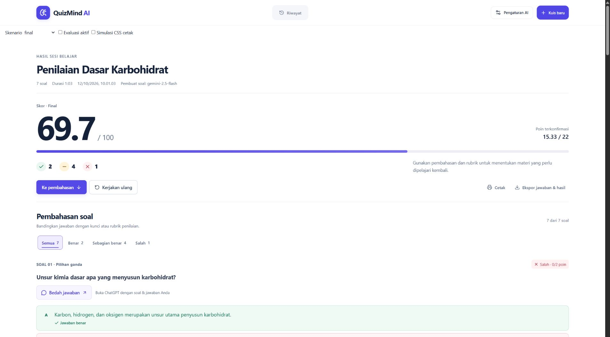
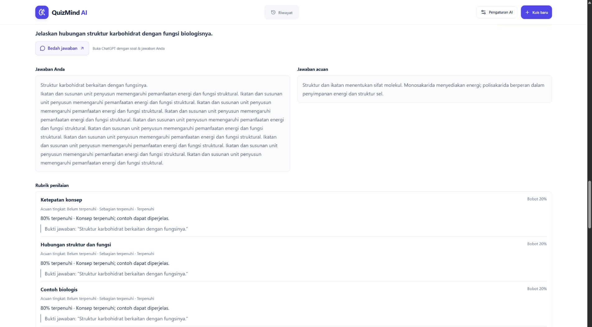
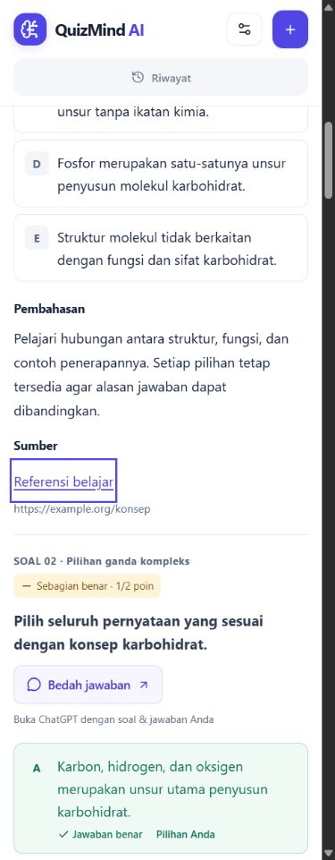

# Widescreen dan bedah jawaban

Perubahan berdasarkan screenshot dan arahan pengguna pada 12 Oktober 2026.

## Layout

Batas 1120px pada hasil dan 85ch pada seluruh pembahasan dihapus. Halaman menggunakan 94% lebar area browser dengan gutter proporsional; header sejajar dengan isi. Mobile menggunakan 100% dengan gutter 14–16px. Mulai 1200px, jawaban tertulis dan acuan berdampingan dalam dua kolom. Rubrik tetap utuh di bawahnya. Semua tujuh tipe, animasi, filter, nilai dan penyimpanan dipertahankan.

| Lebar viewport | Lebar isi review aktual | Overflow horizontal |
| --- | ---: | --- |
| 320px | 276.8px | Tidak |
| 390px | 343.2px | Tidak |
| 768px | 659.6px | Tidak |
| 1440px | 1252.9px | Tidak |
| 1920px | 1675.3px | Tidak |
| 2560px | 2238.5px | Tidak |
| 3440px | 3059.3px | Tidak |

## Bedah jawaban

Setiap soal mempunyai satu tautan **Bedah jawaban**. Klik membuka ChatGPT di tab baru dengan prompt kontekstual melalui parameter `q`. Prompt menjelaskan jenis soal, seluruh opsi/item, jawaban pengguna, kunci/acuan, rubrik dan bukti evaluasi, status/poin, feedback serta referensi. Materi soal ditandai sebagai data, bukan instruksi tambahan. Penilaian yang belum final tidak dianggap salah. Tidak mengirim kredensial, riwayat akun, atau memanggil API generator.

Prompt juga dicoba disalin melalui Clipboard API pada klik yang sama. Jika URL ter-encode lebih dari 6000 karakter, ChatGPT dibuka tanpa query panjang dan pengguna mendapat instruksi tempel serta textarea berisi seluruh prompt. Clipboard ditolak/tidak tersedia juga memunculkan salinan manual. Tidak ada pemotongan esai atau rubrik. Field fallback readonly, berlabel, dapat dipilih dengan keyboard; aksi tidak ikut cetak.

Deep link web diuji langsung dengan prompt sintetis dan prompt lengkap dari fixture pilihan ganda; keduanya terlihat pada composer ChatGPT. Dokumentasi resmi [Commands](https://learn.chatgpt.com/docs/reference/commands) yang ditelaah mendokumentasikan deep link desktop, bukan jaminan kontrak `q` pada web. Pengisian web dapat bergantung pada sesi dan perubahan ChatGPT; fallback tersedia. Clipboard API pada QA browser melaporkan write berhasil, tetapi clipboard yang dibaca melalui alat browser terisolasi kosong; read-back OS tidak diklaim lulus. Jalur copy penuh/success/denied/unavailable diuji dengan adapter dan salinan manual panjang diuji di UI.

## File

- `src/index.css`: lebar proporsional, header, grid jawaban/acuan dan tampilan aksi/fallback.
- `src/components/QuestionReview.tsx`: struktur dua blok jawaban tertulis.
- `src/components/QuizResults.tsx`: aksi per pertanyaan.
- `src/answerDiscussion.ts`: pembangun prompt tujuh tipe, encode tautan, fallback panjang dan copy adapter.
- `src/components/AnswerDiscussion.tsx`: tautan, salinan cadangan, feedback dan salinan manual.
- `scripts/results-review-test.ts`: regresi tujuh tipe, Unicode/URL, prompt panjang, mutasi data dan clipboard.
- Fixture/preview: skenario `long_prompt` untuk jawaban esai 12.000 karakter.

## Pemeriksaan

| Pemeriksaan | Hasil |
| --- | --- |
| `npm run test:results` | PASS seluruh 9 kelompok tes. |
| `npm run lint` | PASS. |
| `npm run build` | PASS frontend/server/Worker; peringatan chunk besar yang sudah ada tetap muncul. |
| `git diff --check` | PASS. |
| Browser 320–3440px | PASS tanpa overflow; tepat tujuh aksi bedah jawaban. |
| Klik bedah soal pertama | Prompt konteks diterima ChatGPT; Clipboard API pada aplikasi resolve sukses. |
| Prompt esai panjang | UI menyediakan prompt lengkap 14.921 karakter dan petunjuk tempel, tanpa query yang terlalu besar. |
| Simulasi CSS print, filter Salah aktif | Tetap tujuh soal; aksi eksternal tersembunyi; jawaban tertulis satu kolom. |

Data QA: `.qa/results-redesign/widescreen-discussion.json`. Pengujian memakai fixture lokal tanpa data pribadi. Tidak ada perubahan backend/scoring/schema/auth dan tidak dilakukan deployment.

